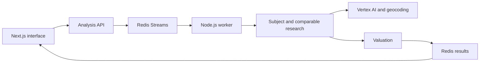

# PropertyVision — complete application

**[Browse the application source](src/) · [Follow the code tour](CODE_TOUR.md) · [Use the live product](https://demo.neoventurez.com/) · [Portfolio home](../../README.md)**

PropertyVision is my first production system, published as the NEO Venturez property-analysis product. Enter an address, follow a background analysis, and inspect property facts, comparable sales, and an estimated after-repair value in a saved report.

This folder contains the full application source snapshot, directly inside the engineering portfolio: the Next.js interface, API routes, Redis queue and persistence, Node.js worker, AI-backed property research, comparable-search pipeline, valuation logic, and application configuration. The code tour follows a request through the actual modules.

## What is in this folder

| Location | Current contents |
| --- | --- |
| [src/app/](src/app/) · [src/components/](src/components/) · [src/hooks/](src/hooks/) | Next.js pages and API routes, report components, search history, and job-progress polling. |
| [src/server/](src/server/) | Queue, worker, research pipelines, provider clients, comparable selection, valuation, and supporting utilities. |
| [src/contexts/](src/contexts/) · [src/services/](src/services/) · [src/types/](src/types/) | Anonymous-demo auth context, search-history service, and shared property types. |
| [public/](public/) · [package.json](package.json) · [.env.example](.env.example) · [Dockerfile](Dockerfile) | Static assets, locked dependency setup, environment template, and container recipe. |
| [CODE_TOUR.md](CODE_TOUR.md) · [SOURCE_MANIFEST.json](SOURCE_MANIFEST.json) · [VERIFICATION.md](VERIFICATION.md) | Request-by-request reading guide, source provenance, and recorded checks. |

The snapshot includes all 80 files in the application's `src/` tree and 5 public assets. Earlier implementations and backup files are preserved alongside the current flow. The queue uses the V10 research pipeline by default; `PV_PARALLEL_SEARCH=off` selects V5 through [parallelSearchConfig.ts](src/server/utils/parallelSearchConfig.ts).

## Follow an analysis through the code

| Layer | Source | What to look for |
| --- | --- | --- |
| Product interface | [page.tsx](src/app/page.tsx) · [progress hook](src/hooks/useJobProgress.ts) | Address submission, job polling, error states, saved results, and comparable tables. |
| API boundary | [analysis route](src/app/api/analyze/route.ts) · [status route](src/app/api/analyze/status/%5BjobId%5D/route.ts) | Request validation, cached-result handling, job creation, and status responses. |
| Background execution | [jobQueue.ts](src/server/utils/jobQueue.ts) · [worker.ts](src/server/worker.ts) | Redis Streams, consumer groups, concurrent job slots, retries, cancellation, and result persistence. |
| Research pipeline | [comprehensive-comp-search-v10.ts](src/server/comprehensive-comp-search-v10.ts) · [step3-find-comparables.ts](src/server/step3-find-comparables.ts) | Subject research, staged comparable searches, filtering, deduplication, and assembly of the valuation inputs. |
| AI integration | [vertex-details.ts](src/server/vertex-details.ts) · [vertex-limiter.ts](src/server/vertex-limiter.ts) | Provider authentication, structured parsing, timeouts, request pacing, and concurrency control. |
| Valuation | [arvCalculator.js](src/server/arvCalculator.js) | Price-per-square-foot selection, outlier handling, adjustment logic, and result metadata. |
| Persistence | [redisClient.ts](src/server/utils/redisClient.ts) · [redisCache.ts](src/server/utils/redisCache.ts) | Redis connection behavior, cache reads and writes, job state, and stored reports. |



## Stack and build

Next.js 15, React 19, TypeScript, Node.js, Redis, Google Vertex AI, and Google Maps geocoding.

From the portfolio root:

```sh
cd projects/propertyvision
npm ci
PV_LOCAL_DEMO=true npm run build
npm run dev
```

The web interface runs on port 3000. A fresh analysis also needs Redis, a worker, and your own provider configuration. Review [.env.example](.env.example), configure local Redis and Google credentials, then run `RUN_WORKER=true PORT=8081 npm run worker` in a separate terminal. The Next.js process reads `.env.local`; the worker's dotenv loader reads `.env`. Keep both local files out of Git. Reading the source and running the recorded build do not require provider credentials. The application package has no `npm test` script; the portfolio root has separate sample tests.

## Checks recorded for this snapshot

The October 15, 2026 publication check completed a clean dependency install and a Next.js build. The built homepage returned HTTP 200 locally; a missing route and the disabled cache diagnostic endpoint returned HTTP 404. See [VERIFICATION.md](VERIFICATION.md) for the commands and evidence boundaries.

The build skips lint and type-check failures under the inherited configuration. Standalone TypeScript and lint checks are not clean. A fresh provider-backed analysis and the Docker image were not tested for this publication; the local build does not establish those behaviors.

## Scope of this publication

This is a source snapshot from my working application, including its uncommitted application changes, prepared for technical review. [SOURCE_MANIFEST.json](SOURCE_MANIFEST.json) records every copied file, its original hash, and publication changes. Operator email and cloud-project defaults were replaced with configurable or fictional values, as were example addresses. The cache diagnostic endpoint returns an unconditional 404 in this publication. Credentials, deployment access, reports, logs, dependency folders, and private history are excluded. The full `src/` tree is included, including older implementations and the anonymous-demo authentication adapter.

The source snapshot is not asserted to be byte-for-byte identical to the live deployment. The included auth adapter is for the anonymous demo, and the progress indicator estimates time rather than measuring completed work. The inherited Next.js configuration skips lint/type failures during its build; a successful build is not a clean type-check claim. The standalone `localDemo.js` reservation functions are not connected to the request path. See [VERIFICATION.md](VERIFICATION.md) for the checks performed on this publication.

## Build context

I built PropertyVision and TaxAhead with less than $1,000 in combined spend. This is my build-spend figure, not a monthly hosting cost. PropertyVision is the live product in my portfolio; TaxAhead and PasturePact are works in progress awaiting their founders' go-to-market launches. I am happy to walk through the architecture, tradeoffs, and more of my work.

## Source import and earlier examples

All 102 tracked files from the [published PropertyVision snapshot](https://github.com/Eobodoechine/propertyvision/tree/9bc3852039e6a807f5e7513bf7ce239b02c1e81c) are included in this folder. Application code, assets, dependencies, and configuration are unchanged. Only this README was adapted for its location inside the portfolio. The portfolio's [provenance.json](../../provenance.json) records every imported path and hash; [SOURCE_MANIFEST.json](SOURCE_MANIFEST.json) preserves the original publication history.

The earlier [address utility](addressNormalizer.ts) and [usage-budget experiment](usage-budget.js) remain as additional examples with their existing portfolio tests. They are separate from the full application in `src/`. The budget experiment is not connected to the application's request path.
