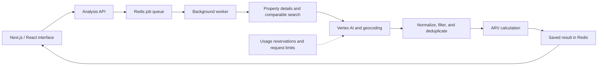

# PropertyVision: end-to-end product walkthrough

**[Open the published product](https://demo.neoventurez.com/)**

PropertyVision is the project behind the NEO Venturez demo URL. It is my first production system and the live, fully integrated product in this portfolio. TaxAhead and PasturePact remain works in progress awaiting their founders' go-to-market launches.

## What to try

1. Open the product without signing in. When a saved report is available, the page opens it immediately.
2. Review the ARV summary, property facts, comparable properties, sale dates, and listing-search links. ARV means estimated after-repair value.
3. Enter a full street address and select **Analyze Property** to request another analysis. The page warns that an analysis can take several minutes. Usage limits can defer new requests.
4. Follow the analysis status, then inspect the resulting estimate and comparable properties.

On October 15, 2026, this portfolio review observed a saved result with an ARV summary and six comparable properties on the public page. It did not submit a fresh analysis or independently validate the underlying sales or valuation accuracy. Listing-search links are a starting point for checking records, not verified source documents.

## How the system fits together

This map follows the inspected source snapshot. The UI submits an address and polls a job identifier. A separate worker runs property analysis, stores progress and results, and records failures. The page can reopen a saved report, so viewing an existing result does not require repeating the analysis.

The source uses Next.js, React, TypeScript, a Node.js worker, Redis, Vertex AI, and geocoding. The public source archive below is an earlier revision; it is not asserted to be identical to the live deployment or this local source snapshot.

## Code to discuss in an interview

| Engineering decision | Public evidence | What it shows |
| --- | --- | --- |
| Normalize inconsistent addresses | [Address matching source](addressNormalizer.ts) | Component-based comparisons and explicit limits of permissive matching. |
| Put limits around AI usage | [Usage-budget source](usage-budget.js) | Reserve estimated usage before a request, reject exhausted allowances, limit concurrent analysis, and retain charges when an outcome is unknown. |
| Test the failure paths | [Budget tests](../../tests/usage-budget.test.mjs) · [Other sample tests](../../tests/samples.test.mjs) | Exhausted allowance, oversized input, locked/corrupt accounting state, expired access, and address mismatches. |
| Connect the interface to provider-backed analysis | [Existing public source archive](https://github.com/Eobodoechine/PropertyVision1) | Earlier application and provider-integration code. More current code can be shared on request. |

The budget module uses local persistent accounting and estimated provider costs. It is an application control, not a guarantee of the provider's invoice or a general distributed billing system. Its tests use temporary fictional accounting files and make no cloud requests.

## Build context

I built PropertyVision and TaxAhead with less than $1,000 in spend. This is my reported build-spend figure, not a monthly hosting price. I built PasturePact in one month. I can walk through more of the codebases and explain my implementation decisions on request.
